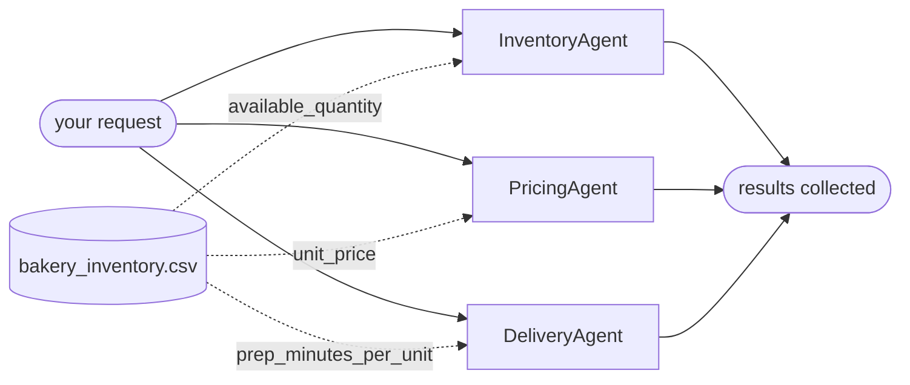

# Concurrent Orchestration

Three bakery specialists receive the same order at the same time and work independently.

This is one of four standalone projects split out of Agent Academy, each
demonstrating a single [Microsoft Agent Framework](https://learn.microsoft.com/agent-framework/)
orchestration pattern. It shares no code with the others: you can clone, run and
read this directory on its own.

## Run it

```bash
./run-local.sh "25 cakes and 75 cookies"
```

That creates `.venv`, installs, runs the tests and then runs `main.py`. Copy
`.env.example` to `.env` and set `FOUNDRY_PROJECT_ENDPOINT` and `FOUNDRY_MODEL`
first, then sign in with `az login`.

Once set up, just:

```bash
.venv/bin/python main.py "25 cakes and 75 cookies"
```

## The pattern



All three start at once and never see each other's output. They share one CSV
but read different columns, so there is nothing to coordinate -- and the file is
uploaded once, not three times.

`ConcurrentBuilder` fans the same request out to every participant and collects the
results afterwards. The branches never see each other's output, which is the point:
inventory, pricing and delivery are independent questions about one order.

**This pattern is not interactive.** Like sequential, every branch has one path to follow,
so the run finishes in one pass with no pending request to answer and nothing to
resume.

## Layout

```
main.py                 the pattern, end to end -- this is the lesson
orchestrations/
  concurrent.py            agent definitions and the fan-out
services/
  foundry.py            Foundry client and CSV uploads
data/                   the CSVs the agents read with Code Interpreter
tests/                  fake workflow, scripted input; no Azure calls
```

## Tests

```bash
.venv/bin/python -m pytest -q
```

Tests drive `main.py` with a fake workflow and scripted keystrokes, so the
pause/answer loop is exercised without contacting Azure or spending model
credits. They do not prove Foundry execution; for that, configure `.env` and
run it for real.

## Data

`data/bakery_inventory.csv` — one row per product, one column per agent:

| column | read by |
| --- | --- |
| `available_quantity` | InventoryAgent |
| `unit_price` | PricingAgent |
| `prep_minutes_per_unit` | DeliveryAgent |

For the default order (100 cupcakes, 50 croissants, 20 cakes) the delivery
estimate works out to 365 minutes, so you can check the agent's arithmetic
against the CSV yourself.

Values are fictional sample data for a tutorial. Delivery timing is a demo estimate, not a promise.
