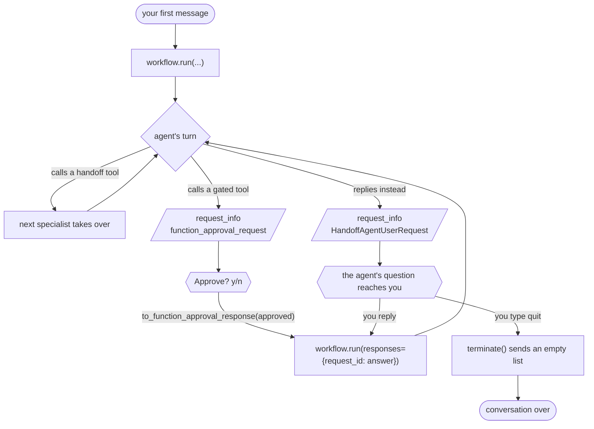

# Handoff + Tool Approval

A handoff conversation that pauses a second time, for a human to approve a simulated financing record.

This is one of four standalone projects split out of Agent Academy, each
demonstrating a single [Microsoft Agent Framework](https://learn.microsoft.com/agent-framework/)
orchestration pattern. It shares no code with the others: you can clone, run and
read this directory on its own.

## Run it

```bash
./run-local.sh
```

That creates `.venv`, installs, runs the tests and then runs `main.py`. Copy
`.env.example` to `.env` and set `FOUNDRY_PROJECT_ENDPOINT` and `FOUNDRY_MODEL`
first, then sign in with `az login`.

Once set up, just:

```bash
.venv/bin/python main.py
```

## The pattern



Two different pauses, both arriving as `request_info`, each answered by a
different call. A single pause is always one kind or the other -- never mixed --
but several approvals can arrive together when one reply triggers several gated
calls.

This is the handoff pattern plus human-in-the-loop tool approval. `approve_vehicle_financing`
is declared `@tool(approval_mode=\"always_require\")`, so the workflow pauses before it runs.

**Two different things can pause this workflow, and both arrive as `request_info`:**

| Pause | Payload | You are asked | Answered by |
| --- | --- | --- | --- |
| Agent waiting on the customer | `HandoffAgentUserRequest` | `You:` | `create_response(reply)`, or `terminate()` if you type `quit` |
| Tool waiting on a decision | `Content` type `function_approval_request` | `Approve? (y/n)` | `to_function_approval_response(approved=...)` |

They are answered by different calls — `create_response` / `terminate` versus
`to_function_approval_response` — so the runtime has to tell them apart rather than treat
every `request_info` alike. Handling only the first is a common bug: an approval request
then gets dropped, the loop exits, and the workflow sits suspended with no error.

`main.py` prints `tool executed:` at the end, read from a dict the tool itself
writes to. So it is true only if an approved call really ran -- you can reject
once and see for yourself that nothing executed.

## Layout

```
main.py                 the pattern, end to end -- this is the lesson
orchestrations/
  handoff_approval.py      agent definitions, handoff rules and the gated tool
services/
  foundry.py            Foundry client and CSV uploads
data/                   the CSVs the agents read with Code Interpreter
tests/                  fake workflow, scripted input; no Azure calls
```

## Tests

```bash
.venv/bin/python -m pytest -q
```

Tests drive `main.py` with a fake workflow and scripted keystrokes, so the
pause/answer loop is exercised without contacting Azure or spending model
credits. They do not prove Foundry execution; for that, configure `.env` and
run it for real.

## Data

`data/vehicles.csv` and `data/loan_options.csv` — listings and rates read with Code Interpreter.

Values are fictional sample data for a tutorial. The financing record is a simulation: no credit decision is made and no transaction is sent.
