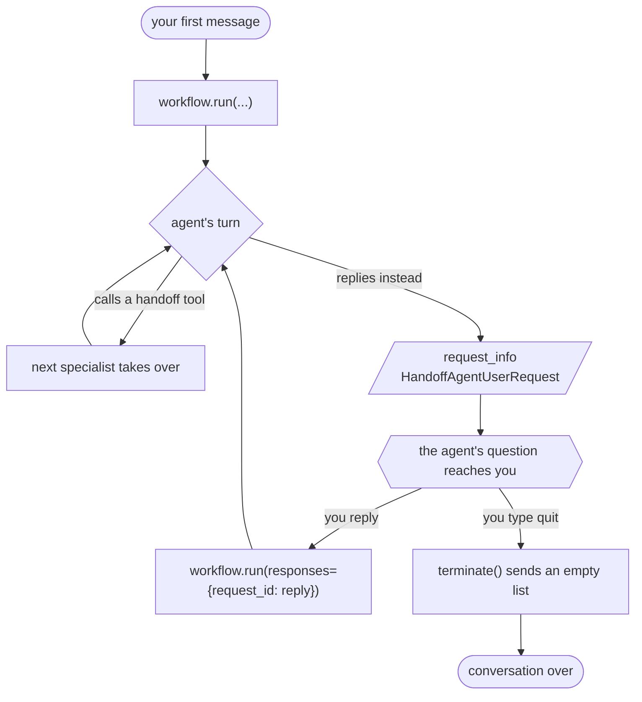
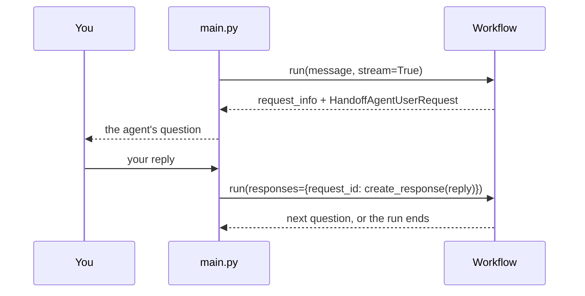

# Handoff Orchestration

Dealership specialists transfer ownership of one conversation as the customer's needs change.

This is one of four standalone projects split out of Agent Academy, each
demonstrating a single [Microsoft Agent Framework](https://learn.microsoft.com/agent-framework/)
orchestration pattern. It shares no code with the others: you can clone, run and
read this directory on its own.

## Run it

```bash
./run-local.sh
```

That creates `.venv`, installs, runs the tests and then runs `main.py`. Copy
`.env.example` to `.env` and set `FOUNDRY_PROJECT_ENDPOINT` and `FOUNDRY_MODEL`
first, then sign in with `az login`.

Once set up, just:

```bash
.venv/bin/python main.py
```

## The pattern



The branch on the right is the whole pattern. An agent either hands off -- and
the run continues with no pause at all -- or it answers you, and the workflow
suspends until you reply. Several agents can speak in a single `run`; only the
last one pauses.

The receiving agent owns the next part of the conversation, and the full history travels
with it.

**Why this is the only interactive pattern.** In sequential and concurrent an agent's
response has exactly one place to go next, so those projects answer in a single request.
Handoff has two: the agent can transfer to a specialist, or it can keep serving the
customer itself. Transfers happen through a *tool call*, so when an agent writes a reply
**instead of** calling a handoff tool, the workflow has no next edge to follow and hands
control back to you. That is the `request_info` event carrying a `HandoffAgentUserRequest`,
and the workflow stays suspended until it is answered.

The framework cannot simply force a handoff every turn either: an agent compelled to
always call the handoff tool could never answer anything. So the pause is unavoidable,
and answering it is the loop `main.py` is built around.



A pending request holds the workflow open, so abandoning it leaves the run
suspended. Typing `quit` answers it with `HandoffAgentUserRequest.terminate()`
instead of another turn of conversation -- ending early still means *answering*.

Agent Framework also offers an experimental `with_autonomous_mode()` on `HandoffBuilder`
that answers these requests automatically with a canned prompt. This project deliberately
does not use it: the pending request *is* the lesson.

## Layout

```
main.py                 the pattern, end to end -- this is the lesson
orchestrations/
  handoff.py               agent definitions and handoff rules
services/
  foundry.py            Foundry client and CSV uploads
data/                   the CSVs the agents read with Code Interpreter
tests/                  fake workflow, scripted input; no Azure calls
```

## Tests

```bash
.venv/bin/python -m pytest -q
```

Tests drive `main.py` with a fake workflow and scripted keystrokes, so the
pause/answer loop is exercised without contacting Azure or spending model
credits. They do not prove Foundry execution; for that, configure `.env` and
run it for real.

## Data

`data/vehicles.csv` and `data/loan_options.csv` — listings and rates read with Code Interpreter.

Values are fictional sample data for a tutorial. Payment examples are illustrative, not financial advice or a credit decision.
