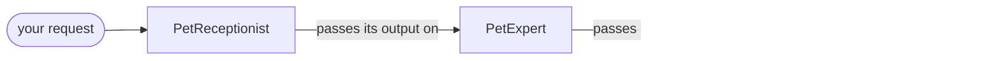

# Sequential Orchestration

Three pet-adoption specialists run in a fixed order, each receiving everything the previous one produced.

This is one of four standalone projects split out of Agent Academy, each
demonstrating a single [Microsoft Agent Framework](https://learn.microsoft.com/agent-framework/)
orchestration pattern. It shares no code with the others: you can clone, run and
read this directory on its own.

## Run it

```bash
./run-local.sh "I want a low-energy pet"
```

That creates `.venv`, installs, runs the tests and then runs `main.py`. Copy
`.env.example` to `.env` and set `FOUNDRY_PROJECT_ENDPOINT` and `FOUNDRY_MODEL`
first, then sign in with `az login`.

Once set up, just:

```bash
.venv/bin/python main.py "I want a low-energy pet"
```

## The pattern



One pass, fixed order. Each agent receives everything the previous one produced,
so nothing can stop and ask you a question -- there is simply nowhere to pause.

`SequentialBuilder` wires the participants into a pipeline. Each agent sees the preceding
conversation and appends its own result, so the order is fixed before the run starts.

**This pattern is not interactive.** An agent's response has exactly one place to go next,
so the workflow always knows its own next step and the server can answer in a single
request. There is no pending request to answer and nothing to resume — compare the
handoff project, where the agent chooses between transferring and replying, and the
workflow has to stop and ask you.

## Layout

```
main.py                 the pattern, end to end -- this is the lesson
orchestrations/
  sequential.py            agent definitions and the pipeline order
services/
  foundry.py            Foundry client and CSV uploads
data/                   the CSVs the agents read with Code Interpreter
tests/                  fake workflow, scripted input; no Azure calls
```

## Tests

```bash
.venv/bin/python -m pytest -q
```

Tests drive `main.py` with a fake workflow and scripted keystrokes, so the
pause/answer loop is exercised without contacting Azure or spending model
credits. They do not prove Foundry execution; for that, configure `.env` and
run it for real.

## Data

`data/pets.csv` — the adoptable pets the PetExpert ranks with Code Interpreter.

Values are fictional sample data for a tutorial. No real adoption service is contacted.
